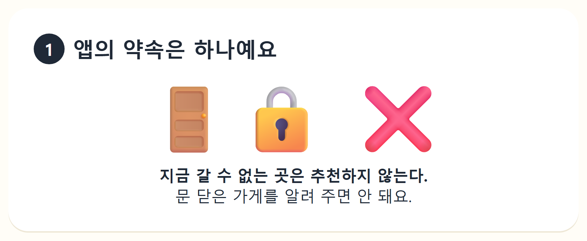
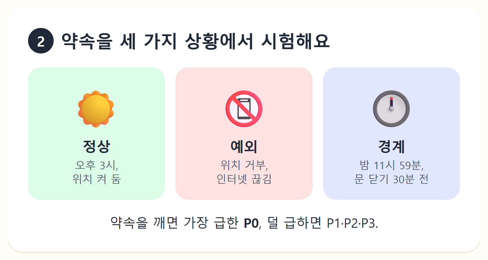
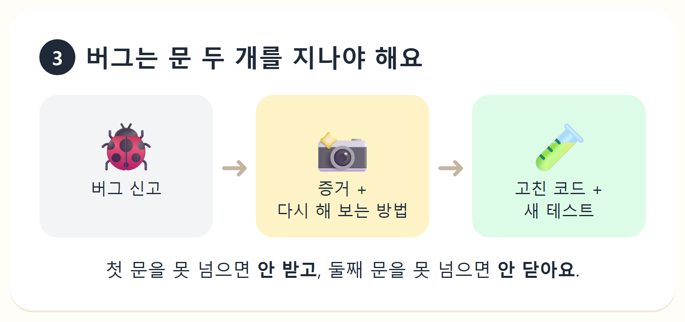
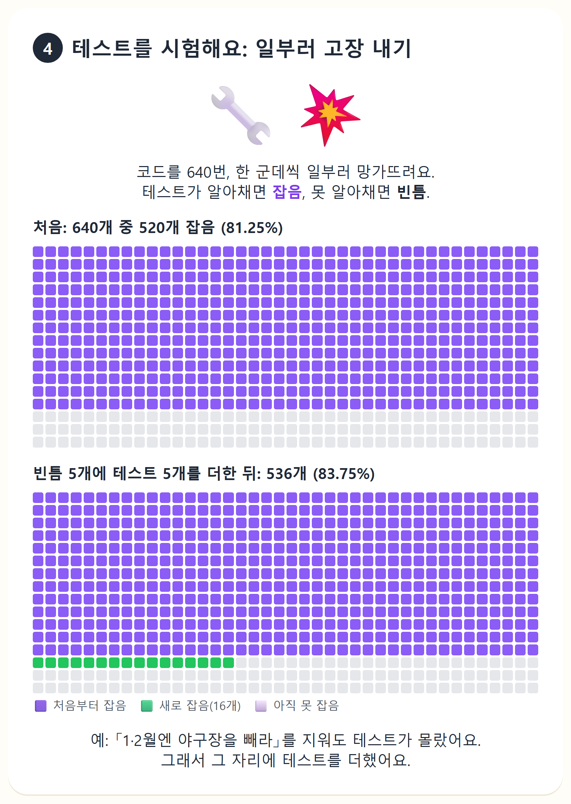
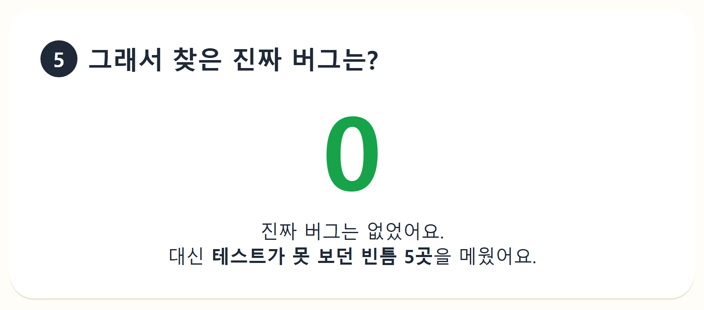

# 여차나 — P를 위한 여행동반자

지금 있는 곳에서 기분 하나를 고르면, **지금 갈 수 있는** 근처 장소 3곳을 골라 주고 바로 길찾기로 보내는 폰 우선 웹 앱(PWA)이다. 로그인은 없다.

- 지역: 제주·부산·강원(강릉·속초·춘천·양양·평창)·서울 25구는 직접 검수한 장소를 쓰고, 그 밖의 전국은 「다른 곳」으로 자동 선정한다.
- 서울 홈: 즐길 거리를 가로 선반으로 보여 준다. 카페·디저트, 밤 놀거리, 그날 공연·전시, 이번 주 팝업 등이 들어가고, 지금 시각에 열린 곳만 나온다.
- 자료: 장소는 검수 뒤 앱과 함께 배포한다. 그날 행사(서울시·KOPIS)는 매일 새로 받는다.

## QA는 이렇게 해요











- QA 규칙 전문: [`.claude/agents/qa-analyst.md`](.claude/agents/qa-analyst.md)
- 돌연변이 테스트 보고서: [`docs/qa/mutation-2026-11-05.md`](docs/qa/mutation-2026-11-05.md)
- 더한 테스트: `apps/web/tests/browse.test.ts`, `apps/web/tests/weekly.test.ts`

## 프로젝트 안내

- 서비스: https://yeochana.com
- 앱 코드: `apps/web` (화면 규칙 `apps/web/design/SPEC.md`)
- 용어: `docs/context.md` · 결정 기록: `docs/adr/README.md`(색인) · 배포: `docs/deploy.md` · SEO: `docs/seo/README.md`
- `apps/api`·`apps/mobile`은 이전 방향(2026-05) 코드다(`docs/adr/0027-mobile-web-frozen-data.md`).

## apps/web 실행

```sh
cd apps/web
npm install
npm run dev      # 로컬 개발 서버
npm test         # 단위 테스트(vitest)
npm run build    # 앱 + 정적 랜딩 빌드
```

옛 API의 로컬 DB 기동: `npm run db:up`
