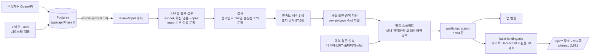
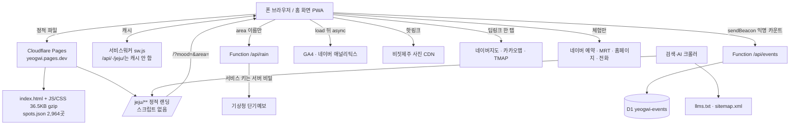

# 포트폴리오 사실 자료 — 「여행귀:제주」

> 작성 2026-10-03. 포트폴리오를 쓸 다른 세션이 쓰는 **원자료**다. 모든 주장 옆에 출처(파일 경로·커밋·ADR)를 단다.
> 여기 없는 것은 확인하지 않은 것이다. 숫자를 바꾸거나 꾸미지 말 것.
> 서비스 주소: https://yeogwi.pages.dev (ADR-0077). 저장소 `C:\Users\rlaal\projects\jeju`, 커밋 180개(2026-05-17 → 2026-10-03, `git rev-list --count HEAD`).

---

## 1. 한 줄 소개 · 문제 · 대상 · 약속

**한 줄 소개(엔티티 문장, ADR-0077 3)**: 「여행귀:제주는 여행 계획 짜기 귀찮은 P를 위한 여행동반자로, 계획 없이 다니는 여행자가 지금 있는 곳에서 기분 하나로 갈 곳 3곳을 받는 제주 무계획 여행 앱이다.」 같은 문장이 `apps/web/public/llms.txt` 첫 단락에 있다.

**이름 표기**: 정식 `여행귀:제주`, 홈 화면 아이콘 이름 `여행귀`, 태그라인 `P를 위한 여행동반자`, 첫 화면 이름 줄 「여행귀:제주 · P를 위한 여행동반자」(`docs/context.md` 33행, ADR-0077 Amendment 1).

**문제 정의(두 번 바뀜)**
- 처음(2026-05-17): 제주 4~5일 여행에 앱 평균 8개를 써서 인지부하·결정피로가 생긴다 → 「도착부터 떠날 때까지 앱 하나」(`docs/grilling_seed.md` §1·§2).
- 지금(2026-09-30 이후): 여행 중 「지금 여기서 뭐하지?」 하는 순간. 사전 계획·일정 짜기는 대상이 아니다(ADR-0025, ADR-0059 2).
- 전환 이유: 「큐레이션 앱으로 변했고, 더 많은·더 정확한 정보 수집에 매달렸다. 사용자 없이 범위만 커지고 마무리가 안 되는 상태」(ADR-0025 Context).
- 기준이 된 경험: 유럽 자유여행 중 밤에 「내일 뭐하지?」 싶으면 그 도시를 검색해 체험을 고르던 경험(ADR-0025 Context).

**대상 사용자**: MBTI P처럼 계획 없이 다니는 여행자. 「지금 여기서 뭐하지?」 할 때 켠다(ADR-0059 Context, `docs/context.md` 33행). 초기 Office Hours의 페르소나는 「가족여행에 끌려가는 30대(Tagalong)」였다(`docs/office_hours.md` D3) — 이후 폐기된 방향.

**핵심 약속**: 미션 「제주에서 머무는 시간을 돌려드린다. 여행을 잘 아는 친구가 옆에 있는 것처럼.」(`docs/context.md` 9행). 판단 기준 11개(A1~A5, B1~B6), 충돌 시 B5 > A5 > A1 > A4(`docs/context.md` 15~29행). 웹 앱에서 자주 인용되는 것: B1 신뢰(환각 없음·출처), B2 가벼움(입력 최소), B3 즉시성, B4 정직(광고 말투 없음), A5 수익과 무관.

---

## 2. 개발 경위 타임라인

커밋 날짜 분포(`git log --format=%ad --date=short`): 05-17 20 · 05-18 21 · 05-23 15 · 05-24 6 · 05-25 2 · **(05-26~09-29 커밋 없음)** · 09-30 37 · 10-01 57 · 10-02 7 · 10-03 15.
주의: 일부 커밋은 UTC로 찍혀 `--reverse` 순서에서 날짜가 앞뒤로 섞인다(예: 745485b가 10-01로 찍혀 09-30 커밋들 앞에 있음).

| 기간 | 단계 | 시작·끝을 만든 결정 | 근거 |
|---|---|---|---|
| 2026-05-17 | **슈퍼앱 구상**. Grilling → Office Hours → Light Spec → Plan → Plan Review → 서브에이전트 배치 1~5 → Codex 리뷰 → 아키텍처 개선. 하루에 전 단계 | Office Hours D4 「가장 좁은 쐐기는 목표가 아니다. 전체 도메인」, D6 「제주 슈퍼앱」. ADR-0001~0015 | `docs/office_hours.md`, f3a18e7, 1863f8a, 6d8ec6f, e50d1d8, 63ef338~12bed10, e80e423, c35d58a, 47631d7~958e29f, `docs/architecture_review.md` |
| 05-17 산출물 | Fastify API 5개, Postgres+pgvector, 카카오 로그인, 일정(DayPlan) 자동 배치 | ADR-0011(카카오 로그인 필수), ADR-0003(ScheduleComposer) | e2c366b, 48e9064, 메모리 `project_core_flow_complete.md`(217 tests) |
| 05-18 | **큐레이션 파이프라인**: 두 갈래 추천(큐레이터 픽/인기), 외부 트렌드 ACL | ADR-0017, 0018 | c5ed559, b4ee938(교차 리뷰 ship-blocking 9건 수정) |
| 05-18~19 | **Phase 0 데이터**: 비짓제주 API 1차 출처, 5슬롯 검증 체인, 네이버 블로그에서 숨은 명소 발굴 + LLM 추출, Gemma 4 26B tool calling | ADR-0023, 0024, 0029(구), 0033, 0040, 0041 | 697e09c, 2bb0cd9, a262e3f(329 tests), 메모리 `project_phase2_tool_calling.md`(428 tests) |
| 05-20 | **발굴 파이프라인 폐기** — 「Naver 발굴 파이프라인 ROI 낮음 검증(실측)」. 비짓제주 점수 기반 1,000건 선별로 전환 | ADR-0029(구) Deprecated, 0033·0040·0041 Deprecated, ADR-0051 | 각 ADR Status 줄 |
| 05-19~22 | 큐레이터 코멘트 생성(Gemma → Claude Haiku), 환각 방지 5단 | ADR-0043, 0045, 0052(Amendment 5: 풀런 수율 78.8%, HHEM 폐기) | 메모리 `project_phase_e_comments.md`(539건 중 425건 성공), 723073a |
| 05-23~25 | 모노레포(`apps/api`), Expo 모바일 앱(홈 포스터 줄·상세·사진 피드·찜) | — | 8286faf, b1a1416, d71d82f~da6695e, 7bb7518 |
| 05-26~09-29 | 커밋 없음 | — | git log |
| **09-30** | **방향 전환** 「내일 뭐하지」 파트너. 로그인 없음, 폰 우선 웹(PWA) + 고정 JSON, 기존 `apps/api`·`apps/mobile`은 지우지 않고 둠 | ADR-0025(신), 0026(신, ADR-0011 대체), 0027(신) | acaa267, f4570eb |
| 09-30 | 웹 앱 첫 빌드 + 보유 3,245곳 전 항목 검수. 맛집 포함·기분 5개, 세부 지역 15곳 + 하트 | ADR-0028(신), 0029(신) | af3f008, d57804c, `apps/web/review/REPORT.md` |
| 09-30 | SPEC 3판 화면, QA 3라운드, 리빌딩 전 제약 재판정(D1~D7 확정, 지표 2개 폐기, Codex 면제) | ADR-0057, 0058 | 80dc252, ea4bc86, 262180b, bf1ae1d |
| 09-30 | 이름 「P의 여행」, 기준 순간 「지금」, 날짜 모드 / 만족도 점수 / 익명 기록 | ADR-0059, 0060, 0061 | ce13abd, 7205e7f, bf67177, fed8f82 |
| 10-01 | 배포 준비: 근거 기반 design.md, 사실 확인, Cloudflare Pages, TourAPI 확장 여지, 새로운 거 하위 분리, 실내만, 오일장, 길찾기·딥링크·llms.txt, 색 「바다·귤」, 지도 앱 선택 | ADR-0062~0067, 0069~0071 | c7704bc, 838a322, 911616f, a672db6, c50c9a4, a84a9c5, 8f38319, 0755756 |
| 10-01 | **이름 변경 1**: 「P의 여행」 → 「여행계획짜기 귀찮아:제주」. App Store에 「P의여행:국도편」(09-03 출시)이 먼저 있었음 | ADR-0068(ADR-0059 1번 대체) | 409d540, `docs/research/name-01.md` §0 |
| 10-01 | **정적 랜딩**(SEO 입구), 예약 검색 링크 중단 → 체험마다 확인된 경로 하나 | ADR-0072, 0073, 0074 | 43df57b, c1b4fd5, 5d25137, d68a191 |
| 10-02 | PR #1 합침(14d91c4 「배포 준비 완료」). 클라우드 세션에서 Pages 업로드가 프록시 문제로 막혀 로컬 배포로 전환 | — | `docs/handoff/2026-10-02-local-resume.md` 「한눈에」 |
| **10-02** | **첫 배포**: 로컬 세션에서 `wrangler pages deploy`(직접 업로드, 첫 배포 `da5500e3.gwichana-jeju.pages.dev`), smoke 18항목 통과. 같은 날 UX 감사가 이 실서비스를 채점 | — | 이 작업 세션 기록(2026-10-02), `docs/research/ux-audit/ours.md` 7행 |
| 10-02~03 | UX 감사 → 목업 A/B → 판정 → A′/B′ → 문제 해결책 → **홈 개편 A′**, **비 소식** Pages Function | ADR-0075, 0076 | fa89b83, 9014fd5, e342e5b, 17de9b6, d22bd62, cd3d679, 6f4172f, 9a276c8, 2486480 |
| 10-03 | **이름 변경 2**: 「여행귀:제주」, 주소 `yeogwi.pages.dev`(옛 주소는 301) | ADR-0077(ADR-0068 1·2·4·5 대체) | ed2ed9e |
| 10-03 | GSC·네이버 서치어드바이저 소유 확인 → 주간 순위 운영 → 분석 상시 연동 → 첫 주간 점검 | ADR-0079, 0078 | d3a7adc, 9c8fcd0, 682d68e, c7b64de, 50ce676 |
| 10-03 | 전국·일본 확장 데이터 출처 조사 | ADR-0062 후속 | 15b4e45, `docs/research/data-sources-korea-japan.md` |

**버린 길과 이유**

| 버린 것 | 이유 | 근거 |
|---|---|---|
| 슈퍼앱·일정 짜기·카카오 로그인 | 사용자 없이 범위만 커짐. 「내일 뭐하지」 순간에 로그인 화면이 뜨면 닫고 검색창으로 간다 | ADR-0025, 0026 |
| 네이버 블로그 숨은 명소 발굴 + Gemma tool calling | 실측 ROI 낮음. 네이버 Hidden 121건 영구 폐기 | ADR-0029(구) Deprecated, ADR-0041 Deprecated, ADR-0042 Amendment 2 |
| trendScore 자동 산정 | 큐레이터 도구 모델로 대체 | ADR-0026(trendscore-curator-tool-model) |
| HHEM 환각 탐지 | 한국어 코멘트에서 통과·실패 모두 약 0.137로 변별력 없음 | 메모리 `project_phase_e_comments.md`, ADR-0052 Am.5 |
| Expo 앱·API 서버 | 밤에 앱을 새로 설치하는 경우는 드물다. 링크 하나로 열리는 웹이 맞다 | ADR-0027(신) |
| spots.json gzip 120KB 기준 | 2,959곳 gzip 약 331KB. 초기 소량 데이터 기준이었다 | ADR-0057 |
| 「한 종결 어미 ≤25%」「끝맺음 같은 화면 ≤5%」 | 앞은 이에요·예요를 따로 세서만 통과하는 지표, 뒤는 우연만으로 약 22%라 도달 불가 | ADR-0058 제약 표 |
| 이름 「P의 여행」 | 같은 이름 앱 선출시, 「P들의 여행」, 네이버 도서·밈과 브랜드 검색 경쟁 불가 | ADR-0068, `name-01.md` §0 |
| 이름 「여행계획짜기 귀찮아:제주」 | 너무 김. 「여행귀」는 처음엔 「뜻이 안 읽힘」으로 반려됐으나, 첫 화면 뜻 풀이로 보완하고 채택 | ADR-0077 Context·3 |
| 마이리얼트립 검색 예약 링크 | 표본 60곳 중 그 장소 상품에 닿은 곳 10곳(17%) | ADR-0073, `booking-links-01.md` §0 |
| 노을 줄(홈) | 노을 볼 곳 데이터가 없음. 원문 판정 전까지 넣지 않음 | `mockup-fixes.md` §1, `.scratch/home-refresh/issues/01-sunset-view-attribute.md` |
| Open-Meteo 날씨 | 무료 API 비상업 전용, KMA 모델 값 null | ADR-0076 Context |

ADR 번호 주의: 0025·0026·0027·0028·0029는 옛 방향과 새 방향에서 번호가 **재사용**됐다(파일 82개, 고유 번호 75개, 0036·0039·0046·0048 없음, `ls docs/adr`). 인용할 때 파일 이름까지 쓸 것.

---

## 3. 제품 설명

**흐름(한 번 쓰는 법)** — `apps/web/public/llms.txt` 「쓰는 법」, `docs/context.md` 37~56행
1. 연다. 로그인 없음(ADR-0026).
2. 기분 하나를 누른다: 푹 쉬고 싶어 / 좀 걷고 싶어 / 새로운 거 해보고 싶어 / 맛있는 거 먹고 싶어 / 아무거나 골라줘(ADR-0028). 먹기는 식사 | 카페·디저트(ADR-0028), 새로운 거는 섞어서·구경·체험(ADR-0064). 아무거나는 먹기를 섞지 않는다.
3. 카드 3장이 나온다: 큰 카드 1장 + 「아니면」 줄 카드 2장(SPEC §14 화면 판정). 사진·이름·이유 한 줄·「차로 약 N분」.
4. 「길찾기」 한 탭으로 지도 앱이 열린다. 출발지는 지금 폰 위치, 차는 자동차·걸어서는 도보·섬은 배 타는 곳까지(ADR-0067, 0069). 지도 앱은 네이버지도 기본, 카카오맵·TMAP 선택(ADR-0071).
5. 마음에 들면 하트. 「다른 3곳 보기」로 다음 세 곳.

**화면·기능**

| 화면·기능 | 내용 | 근거 |
|---|---|---|
| 홈(개편 A′) | 앱 이름 줄 → 오늘 판(날짜 + 회색 접힌 정보, 누를 수 있는 줄 최대 1개: 비 소식 → 노을 → 장날) → 질문 + 「하나 고르면 근처 3곳을 골라 드려요」 → 기분 줄마다 실제 먼저 나올 2곳 사진(52px)과 「예: 이름, 이름」 → 아래 「오늘 장 서는 곳」「다른 동네 둘러보기」 | ADR-0075, 6f4172f |
| 결과 | 카드 3장, 고르는 방식 한 줄, 실내만이면 머리줄 「· 실내만」, 큰 카드 길찾기 48px 버튼 | ADR-0075 5, b459539 |
| 기준 시트 | 언제(지금·내일·날짜) · 어디(여기/숙소/세부 지역 15곳) · 얼마나(걸어서/차로 30분/차로 1시간, 기본 30분) · 비 와요(실내만) | ADR-0059 3, 0029, 0060 3, 0065 |
| 세부 지역 15곳 | 제주시 쪽 8(구제주·신제주·애월·한림·한경·조천·구좌·우도), 서귀포 쪽 7(서귀포시내·중문·안덕·대정·남원·표선·성산). GPS 거절 때도 같은 목록 | ADR-0029(신), `docs/context.md` 41행 |
| 저장 | 하트는 기기에만(`localStorage`). 날짜 모드면 날짜별 보관·순서·다른 날로 옮기기. 백업 링크는 URL `#` 뒤에 담아 서버로 안 감 | ADR-0029, 0059 3, 0063 2, 7205e7f |
| 비 소식 | 앞으로 3시간 강수확률 ≥60%일 때만 「비 소식 · 실내만 볼까요?」. 자동으로 켜지 않음. 출처 「날씨: 기상청」 | ADR-0076 5 |
| 실내 | 2,964곳 중 실내 2,080 · 실외 884(현재 `public/spots.json` 집계). 비짓제주 원문 근거로 판정 | ADR-0065, a875aa5 |
| 오일장 | 오일장 9곳 추가, 「오늘 장 서는 날」「장날: 2·7일」, 장날 우선 정렬 | ADR-0066, c50c9a4 |
| 예약 경로(체험) | 체험 308곳 중 270곳에 확인된 경로 하나: 네이버 124 · 마이리얼트립 9 · 비짓제주 1 · 홈페이지 22 · 전화 114. 경로 없는 38곳은 체험 탭에서 뺌 | ADR-0074, `booking-links-02.md` §0 |
| 딥링크 | `/?mood=&area=&reach=&date=&indoor=` — 랜딩·AI 에이전트가 앱 결과로 바로 들어옴 | ADR-0067, a84a9c5 |
| 차 안 전제 | 동승자가 고르고 운전자는 길 안내만 본다 | ADR-0067, `llms.txt` |

**일부러 하지 않는 것**

| 하지 않음 | 이유 | 근거 |
|---|---|---|
| 평점·별점·리뷰 수 | 「가격·운영시간·평점 없음」 원칙. 만족도 점수는 정렬에만 쓰고 화면·DOM에 없음. 랜딩 JSON-LD에도 `aggregateRating` 없음 | ADR-0025, 0060 4, 0072 6, `specs/ranking.md` R4 |
| 가격·운영시간 | 틀리기 쉬운 정보는 외부 링크에 맡긴다 | ADR-0027 Consequences |
| 로그인·계정 | 그 순간에 로그인 화면이면 닫는다 | ADR-0026, 0063 |
| 일정·동선·시간대 | 「일정 짜기」로 돌아갈 위험. 날짜 모드도 기간 입력·일차 탭 없음 | ADR-0025, 0059 3 |
| 앱 안 예약·결제 | 외부 링크로 넘긴다. 제휴 수수료 링크도 지금은 안 씀 | ADR-0025, `booking-links-01.md` §0 |
| 배지·태그·칩·이모지·그라데이션·그림자 | AI 슬롭 체크리스트 19항목(자동 검사) | SPEC §14, `scripts/check-slop.ts` |

---

## 4. 데이터 파이프라인

**출처**
- 비짓제주(제주관광공사) OpenAPI: 장소 1차 출처(ADR-0023). 사진은 API가 주는 `api.cdn.visitjeju.net` URL을 핫링크, 다운로드·재호스팅 없음(ADR-0072 3). 제주관광공사가 사진 이용 가능을 확인(2026-10-01, `docs/licensing-visitjeju.md` §4, ADR-0072 Amendment 1).
- 카카오 Local API: 지오코딩·검증 단독 소스(ADR-0050). 카카오 ID 없는 곳은 이름 검색 링크(현재 752곳, ADR-0058 D4).
- 예약 경로: 네이버 예약·마이리얼트립·비짓제주·홈페이지·전화를 장소마다 실제 요청으로 확인(`booking-links-02.md`, 원자료 `apps/web/review/booking/routes.json`).
- 기상청 단기예보(data.go.kr 15084084, 공공누리 1유형): 비 소식만(ADR-0076).

**검수·문장·점수**

| 단계 | 결과 | 근거 |
|---|---|---|
| 전 항목 검수 | 사전 필터 통과 3,245곳 전부 판정(누락 0) → keep 3,006. drop: 정보 부족 114, 목적지 아님 83, 부적절 17, 폐업·휴업 13, 체인 11, 가짜 1 | `apps/web/review/REPORT.md` |
| 모델 보정 | 기준 세트 60곳에서 opus vs sonnet keep/drop 일치 98.3%(기준 ≥85%), 기분 98.2%(≥80%) → sonnet 채택. 확신 낮음 1,053건은 opus 재판정 | 같은 파일 |
| 블라인드 감사 | 무작위 162곳 opus 재판정: keep/drop 불일치 3.7%, 기분 불일치 0.7% | 같은 파일 |
| 이유 문장 규칙 | 보유 텍스트만 근거, 15~70자, 끝 마침표 없음, 금지어 0 | `docs/context.md` 56행, SPEC §10 |
| 충실성 감사 | S9-3 opus 170문장: 창작 0, 경계 5 → 경계 7개 원본에 맞게 수정 | 7e74a63, 063840d |
| 만족도 점수 | 원문만 근거로 1~5점 + 근거 한 줄. 교차 감사 ±1 일치 97.3%(기준 ≥85%), 블루리본 규칙 통일 | ADR-0060, `specs/ranking.md`, 099a792 |
| 사실 확인 | 의심 10곳 카카오맵·다이닝코드 확인 → 수정 6건(제거 4·수정 2) | 0a638df, 838a322 |
| 중복 차단 | 한 글자 차이·10m 이내 쌍을 빌드에서 차단 | 0491b9f, `scripts/duplicates.mjs` |
| 잘못된 카카오 ID | 다른 업체·없는 장소를 가리키던 9곳 삭제 | 81e6055 |

**정렬(ADR-0060, `specs/ranking.md`)**: 범위 안 후보 → 점수 내림차순 → 오늘 장 서는 오일장 → 이동 시간 → id. 3곳 미만이면 넓힘(빈손 없음). 점수 분포(현재): 5점 155 · 4점 1,001 · 3점 1,695 · 2점 113.

**곳 수의 변화**: 3,245 검수 → 3,003 → 2,959(중복·좌표 정리, ADR-0058 측정) → 2,955(사실 확인 제거 4, 838a322) → **2,964**(오일장 9 추가, ADR-0066). 현재 `apps/web/public/spots.json` 2,964곳, 필드 `id,name,lat,lng,mood,reason,image,kakaoPlaceId,bookable,indoor,sub,score`.
기분별(현재): 먹기 1,676(식사 1,279 · 카페 397) · 새로운 거 517(체험 313 · 구경 204) · 걷기 454 · 쉬기 317.

**랜딩 품질 게이트(빌드가 멈춤)** — `apps/web/scripts/build-landing.mjs` 21행 `BAR = { maxSimilarity: 0.8, minOwnShare: 0.3, minNearby: 3, sourceRun: 20 }`
- 모든 랜딩 쌍의 본문 5글자 조각 Jaccard < 0.80(최고 0.777), 자기 조각 ≥ 30%, 가까운 곳 ≥ 3(ADR-0072 5).
- 비짓제주 원문(intro·summary·comment)과 **20자 연속 일치 0건**. 원문을 거의 옮긴 이유 문장 9곳은 장소 페이지를 만들지 않음(ADR-0072 4·Consequences).
- 결과: 장소 페이지 2,912쪽, sitemap 2,931 URL(`docs/handoff/2026-10-02-local-resume.md` 표, 682d68e).

**데이터 재생성 원칙**: 새 출처·정기 갱신 없음. 기존 레코드 일회성 수정은 `review/` 또는 git 기록이 있을 때만(ADR-0058 MODIFY). 출하본은 멱등 스크립트 `indoor.mjs`·`new-sub.mjs`·`markets.mjs`·`booking.mjs`·`apply-corrections.mjs`로 고친다(handoff 10-02 사용자 할 일 6).

---

## 5. 아키텍처

- **앱**: 정적 PWA, 바닐라 TypeScript + Vite. `apps/web/package.json`에 런타임 의존성 없음(devDependencies만: vite·vitest·typescript·tsx·jsdom 등). 소스 `apps/web/src/*.ts` 24개 모듈(app·pick·render·state·store·keep·sun·market·links·deeplink·track·analytics 등).
- **번들 예산**: JS+CSS gzip ≤ 50KB(ADR-0058 KEEP). 현재 36.5KB(c7b64de 커밋 메시지). 웹폰트 0(ADR-0058, SPEC §3.1).
- **서비스워커**: 손으로 쓴 `apps/web/sw/sw.js`. 빌드가 파일 해시로 VERSION·PRECACHE를 채우고, 바뀌면 옛 캐시 삭제. `/jeju/**`는 셸로 답하지 않고, `/api/`는 네트워크만(ADR-0072 8, ADR-0076 3).
- **호스팅**: Cloudflare Pages 직접 업로드(`wrangler pages deploy dist`, Git 연결 없음). `_headers`로 해시 자산 1년 immutable, `index.html`·`sw.js`·manifest no-cache, SPA 폴백 없이 `404.html`(ADR-0063, `docs/deploy.md` §1).
- **서버 코드는 Functions 2개 + D1 1개**(ADR-0078 Consequences)
  - `GET /api/rain?area=<slug>`: 기상청 `getVilageFcst`, 15곳 격자표 미리 계산, 엣지 캐시 `s-maxage=1800`, 키 없거나 실패면 204(`functions/api/rain.ts`, `functions/_lib/kma.ts`, ADR-0076).
  - `POST /api/events`: 익명 이벤트를 D1 `yeogwi-events`에 날짜×장소×이벤트 카운터로(`functions/api/events/`, `events/handler.ts`, `migrations/0001_events.sql`).
- **정적 랜딩 생성기**: `vite build && tsx scripts/build-landing.mjs`(`package.json` build). 허브 1·지역 15·조합(keyword gate target만, 지금 `/jeju/seongsan/new/` 1)·장소마다 1쪽. 스크립트 없는 HTML, 영문 슬러그는 한 번 주면 바꾸지 않음(`data/landing/slugs.json` 2,964개)(ADR-0072 1·2).
- **개인정보 설계**: 좌표·숙소 위치는 기기 밖으로 안 나간다. 비 소식은 동네 이름만 보내고 GPS 기준이면 기기 안에서 가장 가까운 동네로 바꿔 보낸다(ADR-0076 4). 익명 기록은 좌표·식별자·쿠키·IP를 보내지도 저장하지도 않음(ADR-0061 2, ADR-0078 1). GA4·네이버 애널리틱스는 쿠키를 쓴다고 privacy에 고지하고, 「기록 끄기」가 셋 다 끈다(ADR-0078 3·4).
- **외부 요청 목록**: 사진 CDN, 외부 링크, 비 소식, 분석 3종뿐(SPEC §12.3 + ADR-0076·0078 예외).

---

## 6. 개발 방식 (AI 협업 엔지니어링)

**워크플로(저장소 `CLAUDE.md` 표)**: 1 Grilling(`docs/context.md`) → 2 Office Hours(`docs/office_hours.md`) → 3 Light Spec(`specs/*.md`) → 4 Plan(`plans/*.md`) → 5 Plan Review → 6 서브에이전트 빌드 → 7 Codex 교차 리뷰 → 8 아키텍처 개선. 「단계 건너뛰지 마」. 결정은 `docs/adr/NNNN-title.md`로.
- 실제 산출물: specs 23개, plans 6개(`ls specs plans`), ADR 82개 파일.
- 웹 앱 기능은 대부분 「ADR → Light Spec → 구현 커밋」 짝으로 들어갔다. 예: ADR-0065 + `specs/indoor.md`(2fd1e5b) → a875aa5·a672db6. ADR-0066 + `specs/market-days.md`(25edac1) → c50c9a4.
- 교차 리뷰 7단계: 5월에는 Codex가 실제로 돌았다(e80e423 「Codex BLOCKERs」, `docs/codex_review_curation.md` CRITICAL 3·MAJOR 6, `codex_review_curation_real.md` 「NO-SHIP」). 9월 이후 계정에서 실행 불가 → 「면제, opus 적대적 코드 감사 3라운드 + 시각 QA로 대체」(ADR-0058), 10-03에도 「확인 실패」로 기록하고 Claude 독립 리뷰로 대신함(2486480).

**검증 게이트(현재 수치)**

| 게이트 | 값 | 근거 |
|---|---|---|
| 타입 | `tsc --noEmit` 0 오류 | c7b64de |
| 단위 테스트 | vitest 31파일 **797개 통과**(2026-10-03 재실행 확인). 많은 파일: pick 149, scenarios 128, data 55, app 49, events 38 | `apps/web/tests/` |
| 테스트 수 추이 | 697(10-01, b53b590) → 705(10-02 handoff) → 754(2486480) → 797(c7b64de) | 각 커밋 |
| e2e | Playwright 69항목(`tests/e2e/browser.e2e.mjs`의 `check(` 69회). 최근 66~67/69, 이미 있던 실패 2개(QA4-datein, T2-hit) + 흔들리는 1건 | c7b64de, `plans/home-refresh.md` e2e 기준선 |
| 슬롭 검사 | `check:slop` 19항목 0건(그림자·이모지·느낌표·과장 낱말·글자 크기 4단계·가운데 정렬 0 등) | SPEC §14, `scripts/check-slop.ts` |
| 대비 | `contrast.test.ts` 10개. 예: 큰 카드 길찾기 글자를 `--main`(4.3:1, AA 미달) 대신 `--text`로 | `plans/home-refresh.md` Plan Review 2 |
| 링크 실측 | `check:links`: 폰 UA 5종 + PC로 네이버·카카오 × 자동차·도보·배 타는 곳 링크를 실제로 따라감 | 106318c, 39e337c |
| 배포 직후 | `smoke.sh`: 캐시 규칙·404·og·canonical·robots·llms.txt·옛 이름 0·분석 4항목 | `docs/deploy.md` §3, c7b64de |
| 분석 꺼짐 방지 | 운영 빌드에서 GA4·네이버·수집 주소 중 하나라도 비면 빌드 실패 | ADR-0078 2, `scripts/analytics-env.ts` |

**사전 등록 기준(돌리기 전에 통과선을 적음)**
- 전 항목 검수: 기준을 실행 전 `plans/tomorrow-picker.md`에 고정(REPORT.md 첫 줄).
- UX 감사: 「확인 못 함」에 짐작 점수 금지, 과제 측정 1회·실패해도 재실행 안 함(`ux-audit-criteria.md` §1).
- 목업 사용자 시험: 5초 이해 4/5 이상, 새 안 과반 선호, 결정 속도 1초 넘게 느려지지 않음, 사진 오해 1/5 이하. 「선호는 올랐는데 속도가 느려지면 속도 우선」(`mockup-judgment.md` §5).
- 노을 속성: 무작위 5% 재채점 일치 85% 이상(`.scratch/home-refresh/issues/01`).
- 순위 운영: 지난주보다 3계단 넘게 하락 또는 10위 밖 이탈 = 경보, 신규 4주 안은 판정 안 함(ADR-0079 2).

**정직성 규칙**: 막힌 조회는 「확인 실패」, 0이나 「없음」으로 바꾸지 않는다. 결과를 바꾸려고 같은 측정을 다시 돌리지 않는다(ADR-0079 6, `rank-naver`의 `check_failed`, 682d68e).

**리뷰가 실제로 잡은 것**
- Plan Review 17항목(10-03): 함수 위치를 실제 배포 방식(직접 업로드)에 맞춤, AA 미달 대비, 홈 글자 크기 3단계 유지, 비 응답 순서 경합, 지역 기준이 GPS 모드로 새는 것, live region 오염 등(`plans/home-refresh.md` 34~57행).
- 독립 리뷰 MAJOR(10-03): 비 소식을 동네당 세션 1회만 묻던 것 → 30분(실패 5분) 뒤 다시 묻고 앱 복귀 때 확인, 동시 요청 1개, 브라우저 캐시가 30분을 더 늘리지 않게 `max-age=0`. 회귀 테스트 4개 추가(2486480).
- 감사 정정(10-03): 「뒤로 가기 두 번째에 앱 밖으로 나감」을 버그로 적었으나, 코드 확인 결과 홈이 첫 기록인 의도된 동작(e2e S17~S20, `nav.test.ts:252`)이라 철회. 「뼈대 카드」「오늘 장날 표시」는 이미 있었고, 사진 alt 감점도 철회(`ux-audit/report.md` 57~66행).
- 5월: 큐레이션 교차 리뷰 ship-blocking 9건(b4ee938), admin 라우트 인증 없음·트랜잭션 없음 등(`codex_review_curation_real.md`).

---

## 7. UX 연구와 디자인 개편

**근거 기반 디자인 규칙**: `apps/web/design/design.md` 33개 규칙(출처·근거 등급·SPEC 대조)(c7704bc). 반영 예: 날짜 입력 16px, 테두리 3:1, 자주 누르는 버튼 48px, 로딩 제한 10초(b3702d4).

**UX 감사(2026-10-02)** — 기준 `docs/research/ux-audit-criteria.md`: 8차원 100점(D1 지금·근처 15, D2 선택 부담 15, D3 카드 20, D4 첫인상 15, D5 시각 15, D6 탐색 10, D7 엄지·접근성 5, D8 상호작용·피드백 5. 초안은 D1·D2에 35를 줬다가 사용자 답변으로 조정). 390px 모바일. 증거 사진 75장(`docs/research/ux-audit/shots/`).

| 서비스 | 총점 | 메모 |
|---|---|---|
| 우리 앱 | 81.9 | 선택 부담 5.0, 근처 4.5. 첫 화면 밀도 1, 5초 이해 2, 사진이 색을 맡나 2 |
| 마이리얼트립 | 65.7 | 근처 먹을 곳·길찾기·아무거나 과제 실패 |
| 오늘제주 | 65.3 | 글자 12단계·색 7개, 카드 태그 6~18개, 거리 오류·폐업 장소 |
| 당근 | 38.0 / 50 | 카드·첫인상·시각만 |
| 네이버지도 | 19.1 / 35 | 카드·탐색·반응만 |
| 카카오맵 | 확인 못 함 | 자동 브라우저 차단(403) |

출처: `docs/research/ux-audit/report.md` §1. 결론: 「고르는 흐름은 가장 낫고, 홈은 가장 약하다」. 홈 위 285px·아래 130px 빈칸, 사진 0장, 앱 이름 0번(§2).

**목업과 판정**
- 1판 A(흰 바탕·오늘 줄·사진 모자이크), B(회색 바탕 + 흰 판·사진 타일)(9014fd5, `apps/web/design/proto-d/a.html`, `b.html`).
- 판정 5질문(Q1 할 일, Q2 작동 원리와 전제, Q3 출처의 이유가 사용자 과제인가 사업 이유인가, Q4 비용, Q5 정직성). 결과: 도움 5, 조건부 5, 답습 2(B 히어로 사진, 핵심 사용자 기준 동네 15장). 「절반쯤은 남들 문법을 옮긴 것」(`mockup-judgment.md` §2·§3).
- 2판 A′·B′: 동네별 실제 결과 사진, 행동으로 이어지는 오늘 줄, 길찾기 버튼은 큰 카드만(17de9b6, `a2.html`, `b2.html`).
- 해결책 3개: 노을 데이터(OSM 해안선 22,866점으로 계산 시험, 글 노을 32곳 중 22곳 맞힘 69%), 「누를 수 있는 줄은 하나」(기분 목록 y≈305 → 245), 날씨 출처 비교(`mockup-fixes.md`).
- 사용자가 **A′ 선택**(2026-10-03, ADR-0075 Context).

**출하된 것**: ADR-0075 1~5 전부(홈 A′, 결과 화면 고침) + 비 소식(ADR-0076). 하지 않은 것: 노을 줄, B′ 큰 사진 타일, 회색 바탕, 데스크톱 전용 배치(`plans/home-refresh.md` 「하지 않는 것」).

**색**: 「바다·귤」 — 흰 바탕, 메인 바다 `#0a6fd6`(다크 `#5aa9ff`), 포인트 귤 `#f06400`(다크 `#ff8a3d`), 주 버튼 메인 채움(ADR-0070, `docs/handoff/2026-10-01-session.md`). 후보 3안은 `apps/web/design/palette.md`.

---

## 8. SEO·GEO·분석 운영

- **출발점**: 첫 감사에서 JS 없는 크롤러에 남는 홈 본문 161자, P0 3건(얇은 셸·랜딩 없음·SITE_URL 없음)(`docs/seo/audit-01.md` 14·23~29행).
- **이전 프로젝트 교훈**: seoulist는 「이길 수 있는 검색어인가를 페이지를 만든 뒤에야 쟀고, 외부 링크 0건인 새 도메인이 헤드 검색어를 노렸다」(`docs/seo/seoulist-postmortem.md` §1) → keyword gate를 먼저 두는 규칙으로(`docs/seo/README.md`).
- **keyword gate 결과**: target 2(「제주도 무계획 여행」 → `/jeju/`, 「성산 근처 체험」 → `/jeju/seongsan/new/`) · watch 9 · kill 13(헤드 검색어 전부)(`docs/seo/keyword-research-01.md` 96~104행).
- **정적 랜딩**: 허브·지역 15·조합 1·장소 2,912쪽. 구조화 데이터 `TouristAttraction`/`Restaurant`/`CafeOrCoffeeShop` + `GeoCoordinates` + `BreadcrumbList`, 허브 `CollectionPage`+`ItemList`(ADR-0072 6). 홈 `<noscript>`와 결과 아래 「동네별로 둘러보기」로 연결(1f2794a).
- **GEO**: `llms.txt`(역할·쓰는 법·딥링크 표·출처·하지 않는 것), 홈 JSON-LD `WebApplication`(6b2618b, ADR-0067).
- **등록**: GSC·네이버 서치어드바이저 소유 확인은 메타 태그(Pages가 `.html`을 308 이동시키기 때문)(d3a7adc, 9c8fcd0, handoff 10-02 「배포 직후」 3).
- **주간 순위 운영(ADR-0079)**: 매주 월요일 아침 이 PC에서. 네이버는 Playwright(`scripts/seo/rank-naver.mjs`, 12개 검색어), 구글은 GSC 실적 화면을 크롬으로 읽어 가져오기(`gsc-import.mjs`), IndexNow(`indexnow.mjs`, 2,931 URL seed). 고침은 로컬 커밋까지 자동, 배포·push는 사람.
- **분석 상시 연동(ADR-0078)**: GA4 + 네이버 애널리틱스 + 자체 익명 기록(D1). 계기: seoulist에서 GA4가 꺼진 채 운영돼 데이터가 안 모였던 사고. 대응은 「꺼진 채 배포 금지」(빌드 실패 + smoke + e2e A1-analytics + 매일 `analytics:health`).
- **첫 주간 점검(2026-10-03, 기준선)**: 네이버 12개 검색어 전부 「없음」(측정 완료, check_failed 0), 구글 전부 「확인 실패」(GSC 「데이터 처리 중」), sitemap 제출 상태 「가져올 수 없음」. D1 7·28일 0건, GA4 지난 7일 활성 사용자 0·실시간 1명, 네이버 애널리틱스 확인 실패(`docs/seo/weekly/2026-10-03.md`, `docs/analytics/2026-10-03.md`).

---

## 9. 숫자로 보기

| 지표 | 값 | 출처 |
|---|---|---|
| 기간 | 2026-05-17 ~ 2026-10-03, 커밋 180 | git |
| 웹 앱 첫 커밋 → 첫 배포 | 2026-09-30(af3f008) → 2026-10-02 | git, `ux-audit/ours.md` 7행 |
| ADR | 82파일(고유 번호 75) | `docs/adr/` |
| 검수한 장소 | 3,245(누락 0) | `review/REPORT.md` |
| 출하 장소 | 2,964 | `public/spots.json` |
| 장소 페이지 / sitemap | 2,912 / 2,931 URL | handoff 10-02, 682d68e |
| 세부 지역 / 기분 | 15 / 5 | ADR-0029, 0028 |
| 검수 모델 일치(opus vs sonnet) | 98.3% | `review/REPORT.md` |
| 만족도 점수 교차 감사 | ±1 일치 97.3% | 099a792 |
| 예약 검색 링크 적중 | 60곳 중 10곳(17%) → 폐기 | ADR-0073 |
| 체험 확인 경로 | 308곳 중 270곳(88%) | `booking-links-02.md` |
| 단위 테스트 | 797(31파일) | vitest 재실행 2026-10-03 |
| e2e | 69항목, 66~67 통과 | c7b64de |
| 슬롭 규칙 | 19항목 0건 | SPEC §14 |
| 번들 | JS+CSS gzip 36.5KB / 예산 50KB | c7b64de, ADR-0058 |
| dist | 파일 2,948개, 약 37MB(Pages 한도 2만 개) | handoff 10-02 |
| UX 감사 점수 | 우리 81.9 / 마이리얼트립 65.7 / 오늘제주 65.3 | `ux-audit/report.md` |
| 랜딩 최고 유사도 | 0.777(기준 <0.8) | ADR-0072 Consequences |
| 실사용 지표 | 아직 없음(D1 0건, GA4 7일 0) | `docs/analytics/2026-10-03.md` |

---

## 10. 배운 점 · 의사결정 원칙 · 남은 과제

**문서에 적힌 원칙(해석 없이 인용 위치만)**
- 범위를 줄여 끝낸다: 「사용자 없이 범위만 커지고 마무리가 안 되는 상태」에서 전환, 수집 파이프라인이 붙을 자리 자체를 없애 구조로 강제(ADR-0025, 0027).
- 지표가 의도를 대신하면 버린다: 도달 불가·꼼수 통과 지표 폐기, 싸고 의미 있는 가드만 유지(ADR-0058 제약 표).
- 보여 주기만 하면 장식이다: 행동이 안 바뀌는 정보는 회색 글자로, 맑은 날엔 날씨를 안 씀(`mockup-judgment.md`, ADR-0075 2, ADR-0076 5).
- 남들이 하는 이유가 사업 이유면 가져오지 않는다(판정 Q3, `mockup-judgment.md` §1).
- 확인된 것만 단다: 검색 링크 대신 장소마다 확인된 예약 경로, 없으면 버튼 숨김(ADR-0073, 0074).
- 원문을 싣지 않는다: 사실만 표시, 이유 문장은 새로 씀, 20자 연속 일치 0(ADR-0072 4, `licensing-visitjeju.md` §4 표).
- 지금 바꾸는 비용이 가장 작을 때 바꾼다: 출시 전 이름 변경(ADR-0068).
- 사고 이력을 규칙으로: seoulist의 GA4 꺼짐 → 빌드 실패 규칙(ADR-0078), 검색어 패배 → keyword gate(`seoulist-postmortem.md`).

**남은 과제**

| 과제 | 상태 | 근거 |
|---|---|---|
| 전국 확장(TourAPI 4.0) | 주 출처로 조사 완료, 착수 시 Light Spec·키 신청 필요. 두 번째 지역 후보 부산·강릉·경주 | ADR-0062, `data-sources-korea-japan.md` §0 |
| 일본 | 단일 출처 없음. Wikidata(CC0) + Commons(파일별 라이선스) + 지자체 오픈데이터, 지역 하나로 시험 권고 | 같은 문서 §0 |
| 노을 속성 `sunsetView` | ready-for-agent, 원문(`review/out`)이 있는 환경에서만 | `.scratch/home-refresh/issues/01-sunset-view-attribute.md` |
| e2e 흔들림·기존 실패 | QA4-datein, T2-hit 실패 + 흔들리는 1건 별도 조사 | c7b64de, `plans/home-refresh.md` |
| 데이터 오류 103건 중 안전한 것 정리, 원문 근접 이유 문장 9곳 재작성 | 남음 | handoff 10-02 남은 작업 2·3 |
| 사용자 시험(5~10명) | 질문·통과 기준만 준비, 미실시 | `ux-audit/report.md` §6, `mockup-judgment.md` §5 |
| 색인 요청·Bing 등록 | 사람 할 일 | `docs/seo/weekly/2026-10-03.md` ⑤ |
| 수익화 | 제주관광공사 상업 이용 확인 뒤 | handoff 10-02 남은 작업 9 |
| ADR-0025 마무리 기준 3(지인 1명 이상 실제 사용, 10-30까지) | 기록 없음 | ADR-0025, ADR-0059 4 |

---

## 11. 포트폴리오 작성자를 위한 메모

**추천 이야기 줄기**
1. **문제**: 8개 앱을 하나로 → 4개월 멈춤 → 「지금 여기서 뭐하지」 한 순간으로 좁힘(§1·§2, ADR-0025).
2. **통찰**: 경쟁(오늘제주 2.5만+ 장소, 마이리얼트립)은 더 많이 보여 준다. 우리는 3장만, 평점 없이, 이유 한 줄로(§3, `ux-audit/report.md` §4-C·D).
3. **제약이 만든 설계**: 서버 없음 → 고정 JSON + 정적 랜딩, 로그인 없음 → 기기 저장 + 백업 링크, 좌표 안 보냄 → 동네 이름만(§5).
4. **증거로 고치기**: 감사 81.9점이지만 홈이 약함 → 목업 → 판정(답습 vs 도움) → A′ → 리뷰가 MAJOR를 잡음(§6·§7).
5. **AI와 일하는 방식**: ADR 82개, 사전 등록 기준, 「확인 실패 ≠ 0」, 모델 보정 98.3%·블라인드 감사(§4·§6).

**스크린숏 배치** (`docs/portfolio/shots/`, 목록과 촬영 방법은 `shots/INDEX.md`)

| 섹션 | 파일 |
|---|---|
| 첫 장면·제품 소개 | 01-home-light, 02-home-dark, 03-home-full, 15-desktop-home, 16-og |
| 흐름(기분 → 3장) | 04-results-food, 05-results-walk-full, 06-results-indoor, 08-any |
| 기준·지역 15곳 | 07-basis-sheet |
| 저장·날짜 모드 | 09-saved |
| 비 소식 | 10-rain-row |
| SEO 랜딩 | 11-landing-hub, 12-landing-area, 13-landing-place |
| 개인정보 설계 | 14-privacy |
| 웹 앱 초기 시안(2026-09-30) | history/early-1..4 — 프로토 A·C 홈(글자만 있는 기분 목록), 프로토 B 맛집 카드, 1차 QA 맛집 결과(`shots/INDEX.md`). Expo 앱 시기 화면은 저장소에 캡처가 없다 |
| UX 감사 | history/before-home, history/audit-* (원본 증거: `docs/research/ux-audit/shots/` 75장) |
| 목업 판정 | history/mockup-a, mockup-b, mockup-a2, mockup-b2 (원본: `apps/web/design/proto-d/shots/`) |
| 개편 결과 | history/before-home ↔ history/after-home 나란히 |

**과장하지 말 것**
- **실사용자 지표 없음.** D1 0건, GA4 지난 7일 활성 0(실시간 1명은 개발 중 접속일 수 있음). 사용자 시험도 미실시. 「사용자가 좋아했다」류 문장 금지.
- **순위 기준선은 전부 없음/확인 실패**(등록 당일). SEO 성과 주장 불가.
- **UX 점수는 감사자 1명(Claude)의 판단**이고 위치 권한 없이 지역을 손으로 골랐다(`report.md` §7). 「경쟁사보다 16점 높다」는 같은 기준표 안의 1인 채점이라는 단서를 붙일 것. 우리 점수는 결과 화면 덕이고 홈은 감점이 몰렸다.
- **목업 판정도 1인 예측**이다(`mockup-judgment.md` §4).
- **데이터 현재성 미확인**: 영업 여부는 확인하지 않았다(`review/REPORT.md` 「한계」, ADR-0028).
- 첫 배포 10-02는 작업 세션에서 직접 확인한 사실이다(직접 업로드라 저장소에는 배포 로그가 없다).
- 스크린숏에는 「기록 켜기」 버튼이 보인다. 실제 분석 데이터를 오염시키지 않으려고 기록을 끈 상태로 찍었기 때문이다(`shots/INDEX.md`).
- 「한 사람 + AI」 구성으로 보이나 역할 분담 기록은 커밋 attribution(`Co-Authored-By: Claude`)과 handoff 문서뿐이다. 비율을 숫자로 말하지 말 것.
- 이름이 세 번 바뀌었다(P의 여행 → 여행계획짜기 귀찮아:제주 → 여행귀:제주). 옛 스크린숏의 이름 표기를 확인할 것.
