# 「여행귀:제주」 포트폴리오 가이드

> **이 문서를 읽는 Claude Code 세션에게**: 이 문서는 포트폴리오를 만들기 위한 입구다. 이 저장소에서 무엇을 왜 어떻게 만들었는지 이야기 순서대로 정리했고, 장면마다 캡처를 붙였다.
> - 숫자와 사실은 [`FACTS.md`](FACTS.md)에 출처(커밋·ADR·파일)와 함께 있다. 이 문서의 숫자는 거기서 왔다. 바꾸거나 부풀리지 않는다.
> - 캡처 목록과 촬영 조건은 [`shots/INDEX.md`](shots/INDEX.md)에 있다.
> - 작성 2026-10-03. 서비스: https://yeogwi.pages.dev

---

## 0. 읽는 순서와 쓰는 법

1. 이 문서를 처음부터 끝까지 읽는다. 이야기 뼈대와 장면별 캡처가 있다.
2. [`FACTS.md`](FACTS.md) §11 「과장하지 말 것」을 먼저 확인한다. 포트폴리오에 쓰면 안 되는 주장이 적혀 있다.
3. 장면을 더 깊이 쓰려면 그 장면에 적힌 원본 문서(ADR·리서치)를 연다.
4. 캡처는 `shots/`(지금 서비스)와 `shots/history/`(변천)에서 고른다. 더 많은 원본 증거는 각 장면의 「원본 증거」 경로에 있다.

포트폴리오 형태별 추천:
| 형태 | 쓸 장면 | 분량 |
|---|---|---|
| 케이스 스터디 웹페이지 | 1~9 전부, 캡처 12~16장 | 길게 |
| 한 장 요약(이력서 첨부) | 30초 요약 + §3·§6·§9 + 캡처 3장(01, 04, before↔after) | A4 1장 |
| 발표 슬라이드 | 장면마다 1~2장, 각 장의 「한 줄」을 제목으로 | 12~15장 |

---

## 30초 요약

**여행귀:제주**는 여행 계획을 짜기 귀찮은 사람(MBTI P)을 위한 모바일 웹 앱이다. 제주에서 「지금 뭐 하지?」 싶을 때 기분 하나를 누르면, 지금 있는 곳 근처에서 갈 곳 **3곳**을 사진·이유 한 줄·「차로 약 N분」과 함께 골라 준다. 길찾기는 한 탭이다.

- **문제**: 처음에는 「여행 앱 8개를 하나로」를 목표로 한 슈퍼앱이었다. 범위만 커지고 끝나지 않아 4개월 멈췄다. 그래서 「지금 여기서 뭐하지?」 한 순간으로 좁혀 다시 만들었다.
- **만든 것**:
  - 비짓제주 데이터에서 직접 검수한 **2,964곳**.
  - 정적 PWA와 Cloudflare Pages Functions 2개(기상청 비 소식·익명 기록).
  - 검색 유입을 위한 장소 페이지 **2,912쪽**.
  - 분석 3종 상시 연동과 주간 SEO·순위 자동 점검.
- **방식**: 한 사람이 AI(Claude Code)와 같이 만들었다. 결정마다 ADR을 쓰고(82개), 통과 기준을 먼저 적은 뒤 측정했고, 검증 게이트를 뒀다(테스트 797개, e2e 69항목, 디자인 슬롭 자동 검사 19항목).
- **기간**: 2026-05-17 ~ 2026-10-03(커밋 180개). 웹 앱은 09-30에 시작해 10-02에 배포했다.

---

## 프로젝트 한눈에

| 항목 | 내용 |
|---|---|
| 서비스 | https://yeogwi.pages.dev (옛 주소 gwichana-jeju.pages.dev는 301) |
| 역할 | 기획·리서치·데이터·디자인·개발·배포·운영을 1인이 AI 에이전트와 수행 |
| 기술 | 바닐라 TypeScript + Vite(런타임 의존성 0), 손으로 쓴 서비스워커, Cloudflare Pages + Functions + D1, Playwright e2e, Vitest |
| 데이터 | 비짓제주 OpenAPI → LLM 전 항목 검수 → 만족도 점수 → 사실 확인 → `spots.json` |
| 운영 | GA4 · 네이버 애널리틱스 · 자체 익명 기록, Google Search Console · 네이버 서치어드바이저, 매주 월 자동 SEO·순위 점검 |
| 이름 변천 | P의 여행 → 여행계획짜기 귀찮아:제주 → **여행귀:제주** |

---

## 1. 출발: 슈퍼앱 구상과 멈춤 (2026-05)

**한 줄**: 「앱 8개를 하나로」는 하루 만에 설계까지 끝났지만, 사용자 없이 범위만 커졌다.

- 05-17 하루에 Grilling → Office Hours → Spec → Plan → 서브에이전트 빌드 → Codex 리뷰까지 워크플로 전 단계를 돌렸다. 결과물은 Fastify API, Postgres·pgvector, 카카오 로그인, 일정 자동 배치다.
- 05-18~25에는 큐레이션 파이프라인, 네이버 블로그 숨은 명소 발굴(LLM tool calling), Expo 모바일 앱을 만들었다.
- 실측해 보니 숨은 명소 발굴은 들인 비용만큼 효과가 없어서(ROI 낮음) 폐기했다(ADR-0029 구, 0041).
- 05-26~09-29에는 커밋이 없다. 「큐레이션 앱으로 변했고 더 많은·더 정확한 정보 수집에 매달렸다. 사용자 없이 범위만 커지고 마무리가 안 되는 상태」(ADR-0025 Context).

포인트: 실패를 숨기지 말고 **전환의 근거**로 쓴다. 버린 길 표는 [`FACTS.md`](FACTS.md) §2 「버린 길과 이유」에 있다.

원본: `docs/office_hours.md`, `docs/grilling_seed.md`, `docs/adr/0025-*`(파일명 주의: 0025~0029는 번호가 재사용됐다).

---

## 2. 전환: 한 순간으로 좁히기 (2026-09-30)

**한 줄**: 「내일·지금 뭐하지?」 하는 순간 하나만 돕는다. 로그인·일정·평점은 일부러 뺐다.

- 기준이 된 경험: 유럽 자유여행 중 밤에 「내일 뭐하지?」 싶을 때 도시를 검색해 골랐던 기억(ADR-0025).
- 결정:
  - 로그인을 없앴다(ADR-0026). 그 순간에 로그인 화면이 뜨면 사람들은 닫는다.
  - 앱 대신 링크 하나로 열리는 웹(PWA)으로 갔다(ADR-0027).
  - 기분 5개와 세부 지역 15곳을 뒀다(ADR-0028, 0029).
- 웹 앱 첫 빌드 날 보유 데이터 3,245곳을 **전부** 검수했다(누락 0).

| 초기 시안 (09-30) | |
|---|---|
| 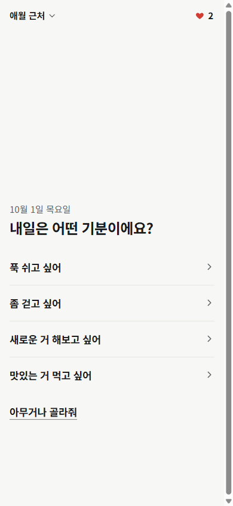 |  |
| 프로토 A: 글자만 있는 기분 목록 | 1차 QA: 큰 사진 1장 + 「아니면」 2곳 구조가 이때 정해졌다 |

더 있음: `shots/history/early-2.png`(프로토 C 홈), `early-3.png`(프로토 B 맛집 카드). 원본 42장은 `apps/web/design/shots/`.

---

## 3. 제품: 기분 하나 → 3곳 → 길찾기

**한 줄**: 고르는 수를 3으로 줄이고, 카드마다 「왜 여기인지」 사실 한 줄을 붙였다.

| 홈 (라이트) | 홈 (다크) | 결과: 맛있는 거 |
|---|---|---|
|  |  | 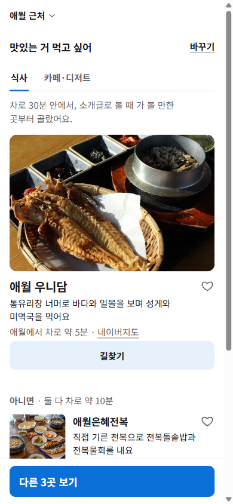 |

- **홈**: 오늘 판(날짜·해 지는 시각·누를 수 있는 줄 최대 1개), 기분 4줄 + 아무거나가 있다. 각 기분 줄에는 **지금 기준으로 실제 먼저 나올 2곳**의 사진과 이름이 붙는다(ADR-0075).
- **결과**: 큰 카드 1장 + 「아니면」 2장이다.
  - 카드마다 사진 · 이름 · 이유 한 줄 · 「애월에서 차로 약 5분」이 있다.
  - 고르는 방식을 한 줄로 밝힌다(「차로 30분 안에서, 소개글로 볼 때 가 볼 만한 곳부터 골랐어요」).
- **길찾기**: 한 탭이면 지도 앱이 열린다(네이버지도 기본, 카카오맵·TMAP 선택, 섬은 배 타는 곳까지).

| 기준 시트 | 아무거나 | 저장 | 실내만 |
|---|---|---|---|
| 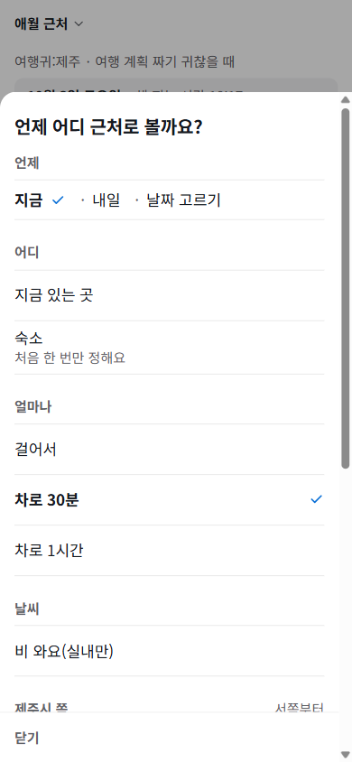 | 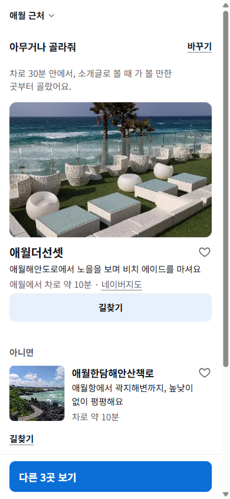 |  | 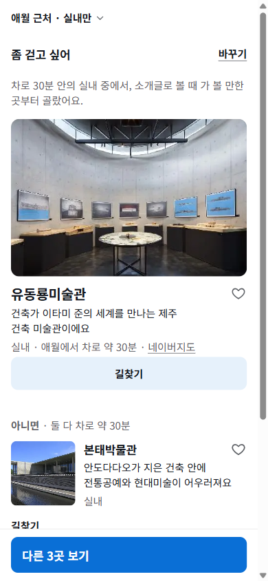 |

- **기준**: 언제(지금·내일·날짜), 어디(내 위치·숙소·세부 지역 15곳), 얼마나(걸어서·차로 30분·1시간), 비 와요(실내만).
- **저장**: 하트를 누르면 기기에만 저장한다. 로그인이 없다. 백업 링크는 URL `#` 뒤에 담아 서버로 가지 않는다.
- **일부러 하지 않는 것**: 평점·가격·운영시간·로그인·일정·앱 안 결제·배지·이모지(이유는 [`FACTS.md`](FACTS.md) §3 표).

전체 흐름 한 장: `shots/03-home-full.png`, `shots/05-results-walk-full.png`. 데스크톱: `shots/15-desktop-home.png`.

---

## 4. 데이터: 2,964곳을 고른 방법

**한 줄**: 많이 모으기보다 **확인된 것만** 남겼다. 원문은 그대로 싣지 않고, 사실만으로 이유 문장을 새로 썼다.

- **검수**: 3,245곳을 전부 LLM(sonnet)으로 판정했다. 확신이 낮은 1,053건은 opus로 다시 판정했다. 기준 세트에서 두 모델의 일치율은 98.3%였다.
- **감사**: 무작위 162곳을 블라인드 재판정했다(불일치 3.7%). 이유 문장 170개 충실성 감사에서 지어낸 문장은 0건이었다.
- **만족도 점수**: 원문만 근거로 1~5점을 매겼다. 교차 감사 ±1 일치율 97.3%. 점수는 정렬에만 쓰고 화면에는 보이지 않는다.
- **사실 확인**: 카카오맵 등으로 의심 장소를 확인했다. 잘못된 카카오 ID 9곳을 삭제했다.
- **예약 경로**: 검색 링크가 맞은 비율이 17%라 폐기했다. 대신 체험 308곳 중 270곳에 **실제로 확인한 경로 하나**를 붙였다.
- **원문 금지 게이트**: 비짓제주 원문과 20자 연속으로 일치하는 문장 0건, 페이지 쌍 유사도 0.8 미만. 하나라도 어기면 빌드가 멈춘다.

다이어그램: [`FACTS.md`](FACTS.md) §4 mermaid 「데이터 파이프라인」. 원본: `apps/web/review/REPORT.md`, `specs/ranking.md`, `docs/research/booking-links-02.md`, `docs/licensing-visitjeju.md`.

---

## 5. 제약이 만든 설계

**한 줄**: 서버 없음 · 로그인 없음 · 좌표 안 보냄이라는 제약이 구조를 정했다.

- **정적 PWA**: 런타임 의존성 0, JS+CSS gzip 36.5KB(예산 50KB), 손으로 쓴 서비스워커.
- **서버 코드는 Functions 2개뿐**:
  - `/api/rain`: 기상청 단기예보. 앱은 동네 이름만 보낸다.
  - `/api/events`: 익명 카운트를 D1에 쌓는다. IP·쿠키·좌표는 저장하지 않는다.
- **개인정보 설계**: 좌표는 기기 밖으로 나가지 않는다. GPS 기준이면 기기 안에서 가장 가까운 동네 이름으로 바꿔 보낸다.

| 비 소식 | 개인정보 안내 |
|---|---|
| 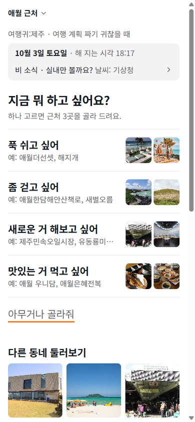 | 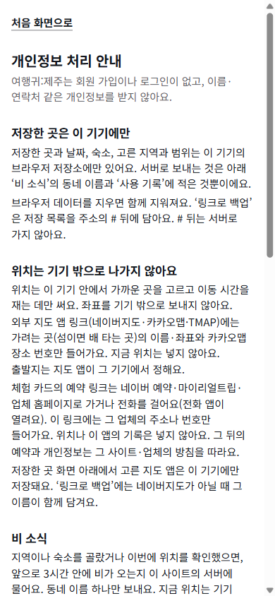 |
| 강수확률 60% 이상일 때만 「실내만 볼까요?」를 묻는다. 자동으로 켜지는 않는다 | 무엇을 보내고 무엇을 안 보내는지, 끄는 법 |

- 「보여 주기만 하면 장식이다」: 맑은 날엔 날씨를 쓰지 않는다. 행동을 바꾸는 정보만 보여 준다(ADR-0076 5).
- 첫 실배포에서 기상청이 키를 거절했다. 함수에 실패 이유 헤더를 붙여 원인을 찾았다: 인코딩 키가 한 번 더 인코딩되고 있었다. 이 경우를 고쳤다(b26f895).

다이어그램: [`FACTS.md`](FACTS.md) §5 mermaid 「아키텍처」.

---

## 6. 증거로 고친 홈 (UX 감사 → 목업 → 판정 → 개편)

**한 줄**: 「홈이 비어 보인다」는 피드백을 감각이 아니라 **기준표와 판정 질문**으로 풀었다.

1. **기준을 먼저 세웠다.** 8차원 100점 기준표를 만들었고, 근거 문헌은 Nielsen, Hick, Lindgaard, Reinecke, WCAG 등이다. 증거가 없으면 「확인 못 함」으로 둔다.
2. **경쟁 서비스를 직접 써 보며 채점했다.** 우리 81.9 · 마이리얼트립 65.7 · 오늘제주 65.3점이다. 하지만 **우리 점수는 결과 화면 덕이고, 홈은 첫 화면 밀도 1점**이었다.
3. **목업 A/B를 만들었다.** 「남들 문법을 답습했나, 진짜 도움인가」를 5개 질문으로 판정했다(할 일 · 작동 원리 · 출처의 이유 · 비용 · 정직성). 결과는 도움 5 · 조건부 5 · 답습 2.
4. **조건부 요소를 고친 A′/B′를 만들어 A′를 골랐다.** 기분 사진은 「지금 위치에서 실제 나올 곳」으로 바꿨다. 오늘 줄은 행동으로 이어질 때만 보이게 했다.

| 개편 전 | 비교: 오늘제주 | 비교: 마이리얼트립 | 비교: 당근 |
|---|---|---|---|
|  |  |  | 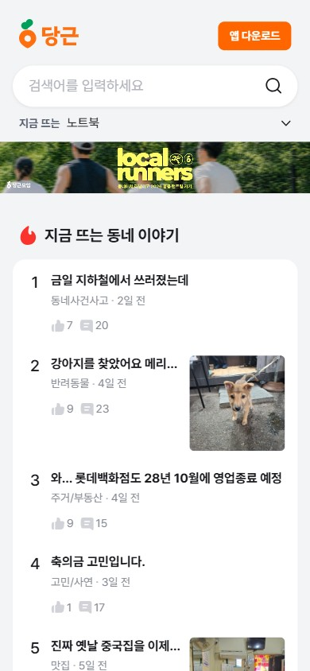 |

| 목업 A | 목업 B | A′ | B′ | 개편 후 |
|---|---|---|---|---|
| 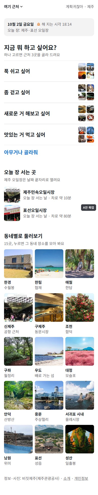 |  |  | 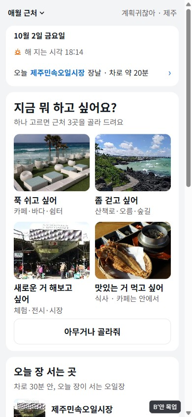 |  |

- 리뷰가 잡은 실수도 쓸 만하다. 감사에서 「뒤로 가기 버그」로 적은 항목은 코드를 확인해 보니 의도된 동작이라 **철회**했다. 「틀린 걸 고쳐 적는 과정」을 보여 줄 수 있다.
- 원본: `docs/research/ux-audit-criteria.md`, `ux-audit/report.md`, `mockup-judgment.md`, `mockup-fixes.md`, 증거 사진 75장 `docs/research/ux-audit/shots/`, 목업 `apps/web/design/proto-d/`.

---

## 7. 검색에 나오게: SEO·GEO

**한 줄**: 이길 수 있는 검색어부터 판정하고(keyword gate), JS 없이도 읽히는 정적 페이지를 만들었다.

- 출발점: JS를 실행하지 않는 크롤러에게 남는 홈 본문이 161자였다.
- **keyword gate**: 페이지를 만들기 전에 검색 결과(SERP)를 보고 판정했다. target 2 · watch 9 · kill 13(헤드 검색어 전부). 이전 프로젝트(seoulist)에서 「만든 뒤에 재서 진」 교훈을 규칙으로 만든 것이다.
- **정적 랜딩**: 허브 1 · 지역 15 · 장소 2,912쪽. 구조화 데이터를 넣었다. 평점 마크업은 없다(점수는 리뷰 평점이 아니다).
- **GEO**: `llms.txt`(역할·쓰는 법·딥링크 표), 홈 JSON-LD, 딥링크 `/?mood=&area=`로 AI 에이전트가 앱 결과에 바로 들어올 수 있다.

| 허브 /jeju/ | 지역 /jeju/aewol/ | 장소 페이지 | 공유 미리보기 |
|---|---|---|---|
|  |  | 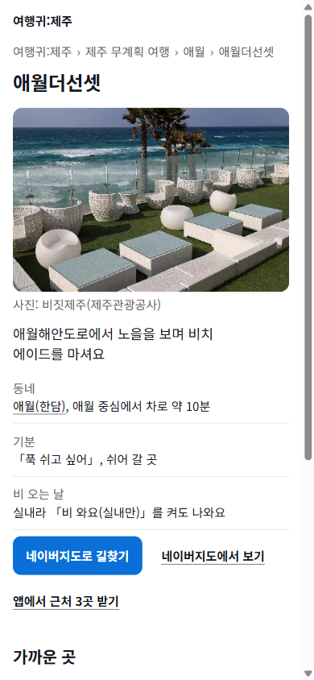 |  |

원본: `docs/seo/`, `docs/adr/0072-*`, `.claude/agents/seo-analyst.md`.

---

## 8. 운영: 꺼지지 않는 분석과 매주 도는 점검

**한 줄**: 이전 프로젝트에서 GA4가 꺼진 채 몰랐던 사고를, 「꺼진 채로는 배포가 안 되는」 구조로 막았다.

- **분석 3종**: GA4 · 네이버 애널리틱스 · 자체 익명 기록(D1).
- **꺼짐 방지**:
  - 운영 빌드에서 하나라도 비면 빌드가 실패한다.
  - 배포 직후 smoke에서 확인한다(운영 데이터를 오염시키지 않는 400 검증 방식).
  - 매일 09시 자동 점검을 돈다.
- **주간 SEO·순위 운영**(매주 월 08:30, 이 PC에서 자동):
  - 순위 측정: 네이버는 Playwright로, 구글은 서치콘솔 실적 화면을 읽는다.
  - 지난주보다 3계단 넘게 떨어지면 경보를 낸다.
  - 안전한 수정은 커밋까지 하고, 배포·push는 사람이 승인한다.
- **정직성 규칙**: 막힌 조회는 「확인 실패」로 남기고 0으로 바꾸지 않는다. 결과를 바꾸려고 같은 측정을 다시 돌리지 않는다.

원본: `docs/adr/0078-*`, `0079-*`, `docs/seo/weekly/`, `docs/analytics/`.

---

## 9. AI와 일하는 방식 (이 프로젝트의 차별점)

**한 줄**: AI에게 「빨리 많이」가 아니라 **결정 기록 · 사전 등록 기준 · 검증 게이트 · 독립 리뷰**를 맡겼다.

- **워크플로**: Grilling → Office Hours → Light Spec → Plan → Plan Review → 서브에이전트 빌드 → 교차 리뷰 → 아키텍처 개선(저장소 `CLAUDE.md`).
- **ADR 82개**: 기존 결정을 뒤집을 때도 새 ADR로 남겼다. 예: 이름 ADR-0068 → 0077.
- **사전 등록**: 감사 기준, 목업 사용자 시험 통과선, 순위 판정 규칙을 측정 **전에** 적었다.
- **리뷰가 실제로 잡은 것**:
  - Plan Review가 구현 전에 17개를 잡았다. 함수 배포 위치, 대비 미달, 글자 크기 규칙 등이다.
  - 독립 리뷰가 MAJOR 1건을 잡았다. 비 소식이 세션당 한 번만 갱신되던 문제다.
  - 감사 오류를 스스로 정정했다.
- **검증 게이트**:
  - 단위 테스트 697 → 797개.
  - e2e 69항목.
  - 디자인 슬롭(그림자·이모지·과장 낱말 등) 자동 검사 19항목.
  - 대비 테스트, 번들 예산.

---

## 10. 숫자로 보기

[`FACTS.md`](FACTS.md) §9 표를 그대로 쓴다. 자주 쓰일 것만 추리면 이렇다.

| 지표 | 값 |
|---|---|
| 기간 / 커밋 | 2026-05-17 ~ 10-03 / 180 |
| ADR | 82 |
| 검수 → 출하 장소 | 3,245 → 2,964 |
| 장소 페이지 / sitemap | 2,912 / 2,931 URL |
| 검수 모델 일치 · 점수 교차 감사 | 98.3% · 97.3% |
| 체험 예약 경로 확인 | 270 / 308 (88%) |
| 단위 테스트 / e2e | 797 / 69항목 |
| 번들 | 36.5KB (예산 50KB) |

---

## 11. 다음 단계 (포트폴리오 끝맺음용)

- **전국 확장**: 한국관광공사 TourAPI 4.0을 주 출처로 조사를 마쳤다. 부산·강릉·경주 중 한 곳에서 시험할 예정이다.
- **일본**: 단일 공개 API가 없다. Wikidata(CC0) + Wikimedia Commons + 지자체 오픈데이터를 조합할 계획이다(`docs/research/data-sources-korea-japan.md`).
- **사용자 시험**: 5~10명 대상으로 질문지와 통과 기준을 준비했고, 아직 하지 않았다.

---

## 쓰면 안 되는 주장 (요약 — 전체는 FACTS.md §11)

- **실사용 지표 없음**(2026-10-03 기준 D1 0건, GA4 7일 0). 「사용자가 좋아했다」 같은 문장은 쓰지 않는다.
- **SEO 성과 없음**: 순위 기준선이 전부 「없음·확인 실패」다(등록 당일이라서).
- **UX 점수는 Claude 1인 감사**다. 「경쟁사보다 16점 높다」를 쓰려면 「같은 기준표의 1인 채점, 우리 점수는 결과 화면 덕이고 홈은 감점」이라는 단서를 붙인다.
- **영업 여부는 확인하지 않았다.**
- **사람과 AI의 작업 비율을 숫자로 말하지 않는다.**
- **캡처의 「기록 켜기」 버튼**은 분석 데이터 오염을 막으려고 기록을 끈 상태로 찍어서 보이는 것이다.

---

## 직접 확인하는 법

- 서비스: https://yeogwi.pages.dev (폰으로 열면 실제 크기). 장소 페이지 예: https://yeogwi.pages.dev/jeju/aewol/
- AI용 설명: https://yeogwi.pages.dev/llms.txt
- 저장소 주요 경로:
  - `docs/adr/`: 결정 기록.
  - `docs/research/`: 리서치·감사.
  - `apps/web/src/`: 앱.
  - `apps/web/functions/`: 서버 함수.
  - `apps/web/scripts/`: 빌드·SEO·분석 스크립트.
  - `apps/web/tests/`: 테스트.
